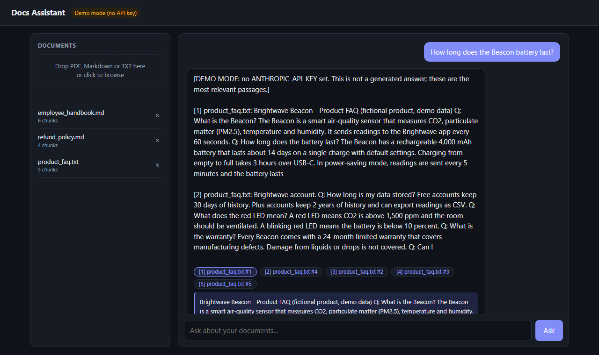
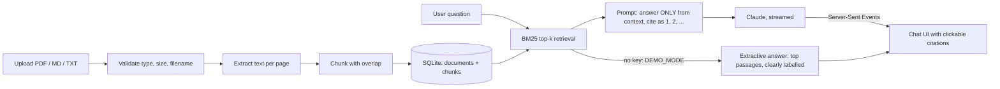

# docs-rag-assistant

[](https://github.com/Aleksa5000/docs-rag-assistant/actions/workflows/ci.yml)


**Chat with your company documents.** Upload PDFs, Markdown or text files, ask questions in plain English, and get answers drawn from your documents, with clickable sources (file plus page or chunk). The model is instructed to answer only from the retrieved passages and to say it couldn't find the answer otherwise; the passages it was given are shown next to every answer so a human can check it.



## The business problem

Policies, handbooks, contracts and product manuals live in folders nobody reads. Employees and customers ask the same questions again and again, and support teams spend hours pointing at page 14 of a PDF. A general chatbot is not the answer: it does not know your documents and it will confidently invent answers.

This project is a small, readable reference implementation of the fix: **retrieval-augmented generation (RAG)**. The model only sees the passages retrieved from your own documents, is told to answer from those alone and to cite them, and the UI shows those passages so a human can verify the answer.

## How it works



1. **Ingest:** files are validated (extension, size, PDF signature), filenames are sanitised, text is extracted (per page for PDFs) and split into overlapping word windows (90 words, 25 overlap) stored in SQLite.
2. **Retrieve:** BM25 (`rank_bm25`) ranks chunks against the question. No embedding API, no vector database, no extra cost. Chunks with zero term overlap are never returned.
3. **Generate:** the top-k chunks are sent to Claude with a strict system prompt, each wrapped in a `<passage>` tag (document text is escaped so it cannot fake those tags). The answer streams to the browser over Server-Sent Events. If no chunk shares a single term with the question, the model is not even called and the reply is "I couldn't find that in the documents." Otherwise the "not found" reply depends on the model following its instructions, and in demo mode the top passages are returned even when they are only loosely related. A truncated or declined answer ends with a short note saying so.
4. **Cite:** the sources event arrives first, so the UI shows a chip for every retrieved passage immediately. Clicking one reveals the exact passage. The inline `[1]`, `[2]` markers come from the model and are not checked against the chips.

## Features

- Upload PDF, Markdown and TXT; list and delete documents
- Prompted to answer from the documents only and cite passages as `[1]`, `[2]`; every retrieved passage is shown with its file and page/chunk
- Token-by-token streaming over SSE (POST + `fetch`, no build step, no framework)
- **DEMO_MODE:** works without any API key by returning the top retrieved passages as a clearly labelled extractive answer
- Upload validation: type allow-list, size limit (enforced from `Content-Length` before the body is read), PDF magic-byte check, empty or scanned-PDF detection, path-safe filenames
- Optional API-key auth (`X-API-Key`, constant-time compare) for all `/api` routes except `/api/health`; `/docs` and the OpenAPI schema are turned off when a key is set
- Configurable model via `CLAUDE_MODEL` (default `claude-haiku-5-5`)
- Tests need no network and no key; Docker, Docker Compose and GitHub Actions CI included

## Quickstart

### Local

```bash
python -m venv .venv && source .venv/bin/activate    # Windows: .venv\Scripts\activate
pip install -r requirements.txt
uvicorn app.main:app --reload
```

Open http://127.0.0.1:8000, drop the files from `sample_docs/` into the sidebar and ask, for example, *"How many vacation days do employees get?"* or *"Can I get a refund on an annual subscription?"*.

Without `ANTHROPIC_API_KEY` the app runs in demo mode. For real generated answers:

```bash
export ANTHROPIC_API_KEY=sk-ant-...      # Windows PowerShell: $env:ANTHROPIC_API_KEY="sk-ant-..."
uvicorn app.main:app
```

### Docker

```bash
cp .env.example .env          # optionally add ANTHROPIC_API_KEY
docker compose up --build
```

The database and uploaded files live in the `data` volume. The container runs as an unprivileged user (uid 10001); a `data` volume created by an older, root-run image needs a one-time `docker compose run --rm --user root app chown -R 10001 /data`.

Compose publishes the app on `127.0.0.1:8000` only. **Auth is off until you set `APP_API_KEY`.** Without it, anyone who can reach the port can upload, list and delete documents and spend your Anthropic credits, and any web page you visit can upload files to a local instance through a cross-site form post. Set `APP_API_KEY` before you publish the port on another interface or put the app behind a proxy. The app logs a warning at startup when it is unset.

### API

| Method | Path | Purpose |
|---|---|---|
| GET | `/api/health` | Status, model, demo flag (always open) |
| GET | `/api/documents` | List documents with chunk counts |
| POST | `/api/documents` | Upload (multipart field `file`) |
| DELETE | `/api/documents/{id}` | Remove a document and its chunks |
| POST | `/api/chat` | Body `{"question": "..."}`; responds with `text/event-stream` |

Chat events: `sources` (JSON with numbered citations), then repeated `token` (`{"text": "..."}`), optionally `error`, and finally `done`.

## Configuration

| Variable | Default | Description |
|---|---|---|
| `ANTHROPIC_API_KEY` | _(empty)_ | Enables real answers. Empty means DEMO_MODE. |
| `CLAUDE_MODEL` | `claude-haiku-5-5` | Any Claude model ID |
| `DEMO_MODE` | _(unset)_ | Set to `1` to force demo mode even if a key is present |
| `APP_API_KEY` | _(empty)_ | If set, `/api` routes except `/api/health` require header `X-API-Key`, and `/docs`, `/redoc` and `/openapi.json` are disabled. Leave empty only for local use. |
| `MAX_UPLOAD_MB` | `10` | Upload size limit. Uploads whose `Content-Length` is over it (plus 64 KB of multipart overhead) are refused with 413 before the body is read; uploads without `Content-Length` get 411. Behind a reverse proxy, set its body limit too (e.g. nginx `client_max_body_size`). |
| `TOP_K` | `5` | Passages retrieved per question (minimum 1) |
| `DB_PATH` | `docs.db` | SQLite file (`/data/docs.db` in Docker) |
| `UPLOAD_DIR` | `uploads` | Where original files are kept |

## Tests

```bash
pip install -r requirements-dev.txt
pytest -q
ruff check .
```

The suite covers chunking and overlap, BM25 ranking and the "no match" case, filename sanitising and upload validation, the API (upload, list, delete, auth, PDF page numbers) with FastAPI's `TestClient`, the generation path with a **mocked Anthropic client** (prompt grounding, model selection, API errors) and the exact SSE wire format. Nothing touches the network.

## Scaling to production

This repo is deliberately small. For a real deployment I would change:

- **Embeddings instead of (or alongside) BM25.** BM25 is excellent for exact terms, product names and codes, but it misses paraphrases ("time off" vs "vacation"). Add an embedding model (Voyage, OpenAI, or a local sentence-transformers model), store vectors in **Postgres + pgvector**, and combine both rankings with reciprocal rank fusion (hybrid search). Only `store.search()` has to change.
- **Do not rebuild the index per query.** Today every question re-reads, re-tokenizes and re-indexes every chunk, so its cost grows linearly with the corpus. That is fine for a few thousand chunks. Beyond that use pgvector/OpenSearch, or cache the index and invalidate it on upload and delete.
- **Better chunking:** split on headings and paragraphs, keep section titles with each chunk, and add a re-ranker for the top 20 results.
- **Background ingestion** (a task queue) and OCR for scanned PDFs.
- **Multi-tenancy and real auth:** per-user or per-team document scopes, OIDC/JWT instead of a single shared key, row-level filtering in retrieval.
- **Conversation memory:** pass recent turns and rewrite follow-up questions into standalone queries before retrieval.
- **Prompt caching and evals:** cache the stable system prompt, and keep a small question/expected-source set to track retrieval quality and answer faithfulness on every change.
- **Operations:** structured logging with request IDs, rate limiting, object storage (S3) for files, Postgres instead of SQLite for concurrent writers.

## Limitations and security

- **Prompt injection is mitigated, not prevented.** Passages are wrapped in escaped `<passage>` tags and the system prompt tells the model to treat them as data, but a document written to manipulate the model can still influence its answer.
- **The corpus is shared.** Every uploader writes to the same document set: everyone when `APP_API_KEY` is unset, and every holder of the single shared key otherwise. There are no per-user scopes.
- **No rate limiting.** Anyone allowed to call `/api/chat` can spend Anthropic credits as fast as they can send questions.
- **Citations are not verified.** The chips show what was retrieved, not what the model actually used.

## Project layout

```
app/main.py      FastAPI routes, SSE, auth
app/ingest.py    validation, filename safety, text extraction
app/chunking.py  overlapping chunks, tokenizer
app/store.py     SQLite storage + BM25 retrieval
app/llm.py       prompt, Claude streaming, demo mode
app/static/      single-page UI (vanilla HTML/CSS/JS)
sample_docs/     fictional handbook, refund policy, product FAQ
tests/           pytest suite (no network)
```

## Need something similar?

I build document Q&A, support copilots and other LLM integrations for small teams. **Need something similar? Contact me on Upwork** (Aleksa Djorovic), or open an issue here.

## License

MIT, see [LICENSE](LICENSE).
